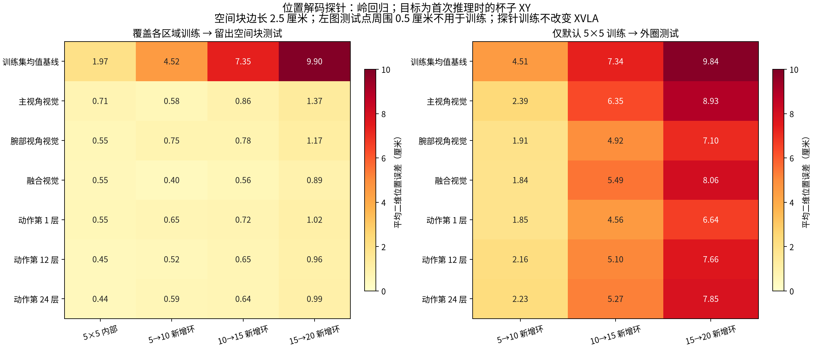
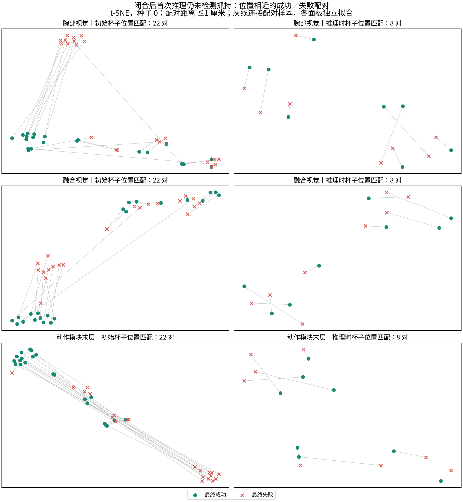

# XVLA 位置泛化与内部特征分析

原版 XVLA 在 LIBERO 衍生仿真场景中的位置泛化实验，以及基于已保存动作重放的内部特征分析。报告和图表以中文为主。

**范围：同一场景、机器人初态、杯子朝向和推理种子。不是完整 LIBERO 基准成绩，也不构成失败原因的因果证明。**

## 实验结果

开始前移动白杯，目标为将白杯放到左盘；场景中的其他杯子保留。原模型，无 LoRA，无抬高或回原位恢复策略；每次最多520步，30步动作块。

| 采样区域 | 次数 | 稳定成功 |
|---|---:|---:|
| 5×5 cm 内部 | 100 | 89% |
| 10×10 cm，排除内部5×5 | 100 | 36% |
| 15×15 cm，排除内部10×10 | 100 | 8% |
| 20×20 cm，排除内部15×15 | 100 | 0% |

区域中心为世界XY=(-0.10,-0.15)m。先过滤初始碰撞等无效布局，再均匀采样；未按模型成功结果筛选。成功要求连续20步目标成立、未被抓持且速度低于0.01m/s。

## 分析结果


- **降维**：400条轨迹首次推理，每条一个点；6组1024维特征，t-SNE和UMAP各3组参数、3个种子，共108个嵌入。没有PCA。主图参数在运行前固定；成功/失败的聚集同时与位置相关。
- **位置探针**：覆盖各区域训练、留出空间块测试时，最外环融合视觉和动作末层的平均二维误差分别为0.89cm和0.99cm。只用默认区域训练线性探针时，最外环误差分别为8.06cm和7.85cm。探针能力不等于原策略利用位置的能力。
- **动作响应**：首次闭合指令发出前，末端参考点到杯子的水平距离中位数为2.83、4.26、5.58、7.92cm。这不是指尖接触误差；首次闭合也不等于实际抓取时刻。
- **阶段分解**：未触发抓持检测的轨迹随范围扩大而增多；但其中21条仍出现杯子抬高，不能将检测标签直接当作物理抓取/掉落真值。



## 报告导航

- [t-SNE / UMAP 方法、参数扫描与局限](analysis/mug_feature_analysis_20261118/README.md)
- [失败阶段、位置解码与动作响应](analysis/mug_mechanism_analysis_20261118/README.md)
- [中文失败阶段图](analysis/mug_mechanism_analysis_20261118/failure_stages_zh.png)
- [中文动作响应图](analysis/mug_mechanism_analysis_20261118/action_response_zh.png)
- [中文位置着色对照](analysis/mug_feature_analysis_20261118/tsne_outcome_position_comparison_zh.png)

## 首次闭合与纠偏分析更新

- [事件对齐：首次闭合、抓持检测丢失后的再推理与纠偏](analysis/mug_correction_analysis_20261118/README.md)
- [首次闭合前后特征的 t-SNE](analysis/mug_close_embedding_20261118/README.md)
- [未检测抓持样本：位置相近的成功／失败配对](analysis/mug_close_matched_20261118/README.md)

最新配对分析筛选出275条轨迹（46成功、229失败）。在1cm水平距离限制下，按初始杯子位置得到22对，按推理时杯子位置得到8对，一对一且不重复使用轨迹。初始位置配对虽有特征差异，但推理时杯子XY差中位数已达7.37cm；不能当作状态相近的比较。按推理时位置配对后，仅8对，尚不足以支持稳定区分成功与失败的结论。抓持检测为假不等于物理上完全没有抓住或搬动杯子。



新增目录包含中文PNG/PDF、分析代码、事件指标、配对名单和二维坐标。完整隐藏特征仍未公开。新增的 `analyze.py` 需要完整特征数据，使用 `XVLA_DATA_DIR` 指定数据目录；仅浏览报告与图表无需这些数据。纠偏分析目录的 `plots.py` 可直接使用已公开的统计结果重绘。

## 本次公开内容

包含分析代码、中文PNG/PDF、数值汇总、探针预测、采样坐标、108组二维嵌入、运行设置，以及实验和特征采集的参考脚本。没有令牌、本机用户目录、模型权重、完整隐藏特征、原始观测图像或视频。

**完整特征数据尚未公开，也没有已经发布的 Hugging Face 数据集。** 本地采集了400条轨迹、5,526个推理点，完整特征约12.63GB，池化特征约253MB；这些大文件不在本仓库。报告中部分本地文件引用因此暂不可下载，不能将此仓库当作完整原始数据发布。

12条试采集先通过无采集/有采集动作一致性验证，再扩展到400条。所有轨迹的保存位置、速度和重算动作与原记录最大误差为0。原始历史输入图像没有无损基准可比，因此没有声称原始像素逐像素验证一致。

## 重绘公开图表

```bash
python -m venv .venv
# 激活新环境后：
python -m pip install -r requirements-analysis.txt
python analysis/mug_feature_analysis_20261118/plot_chinese.py
python analysis/mug_mechanism_analysis_20261118/plots.py
```

中文绘图使用 Noto Sans CJK。脚本默认字体路径 `/usr/share/fonts/opentype/noto/NotoSansCJK-Regular.ttc`；其他系统请在绘图脚本中改为已安装的中文字体。

上述重绘使用仓库内的二维坐标、标签和统计结果，不需要完整模型或特征。代码没有重新生成模拟轨迹。

若已有完整特征数据，可设置 `XVLA_DATA_DIR` 指向包含 `pooled_features.npz`、`query_index.jsonl`、`manifest.json`、`episodes/` 的目录，再运行分析脚本。当前大数据未公开，所以全量从特征重新拟合仅适用于已有该数据的用户。

`reference/` 是原实验/采集脚本的脱敏快照，依赖额外的 LIBERO-MAX、LIBERO-plus、LeRobot、模型及本地兼容启动器；不是独立的一键仿真安装包。未打包上游软件或权重，参考脚本中的workspace/data路径为占位路径。

## 来源与版本

- [XVLA checkpoint](https://huggingface.co/lerobot/xvla-libero)，revision `12e8783e996944f5c97e490d37d4c145484ed70a`；模型卡标注Apache-2.0。
- [X-VLA](https://github.com/2toinf/X-VLA)
- [LeRobot](https://github.com/huggingface/lerobot)，本地版本 `dd5313e305ff7aaa5b6c7b4769d1b26650ce250b`
- [LIBERO-MAX](https://github.com/liberomax/LIBERO-MAX)，`01625e290b1aa07511bdc820781e635e851353cc`
- [LIBERO-plus](https://github.com/sylvestf/LIBERO-plus)，`4976dc30028e805ff8094b55501d532c48fec182`
- [LIBERO](https://github.com/Lifelong-Robot-Learning/LIBERO)

请引用相应上游工作。项目间的许可证相互独立；本次公开不授予上游资产或模型的额外权利。详见 [使用范围](USAGE.md)。
