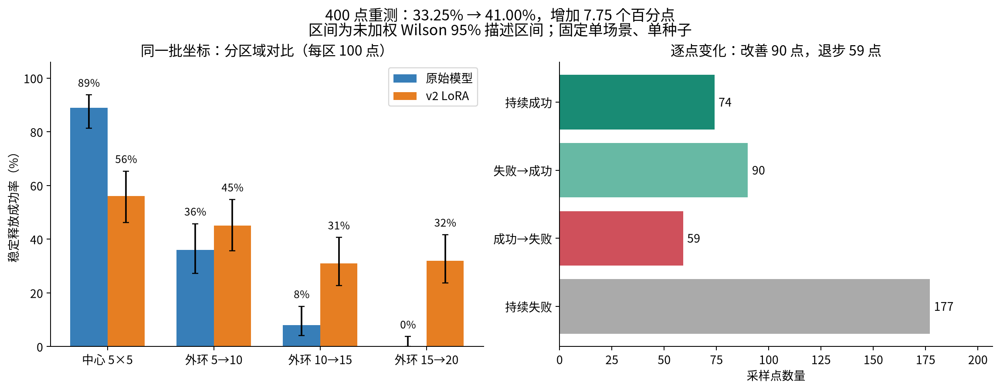
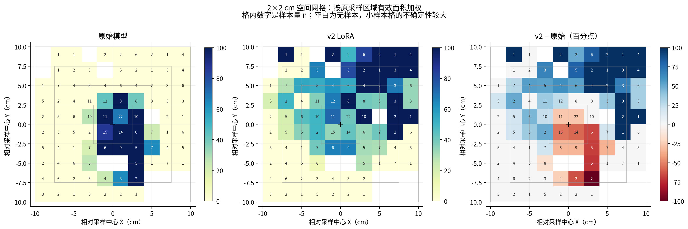
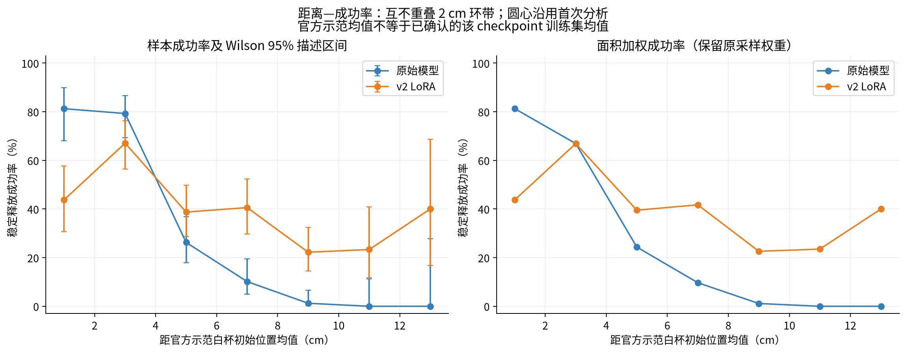
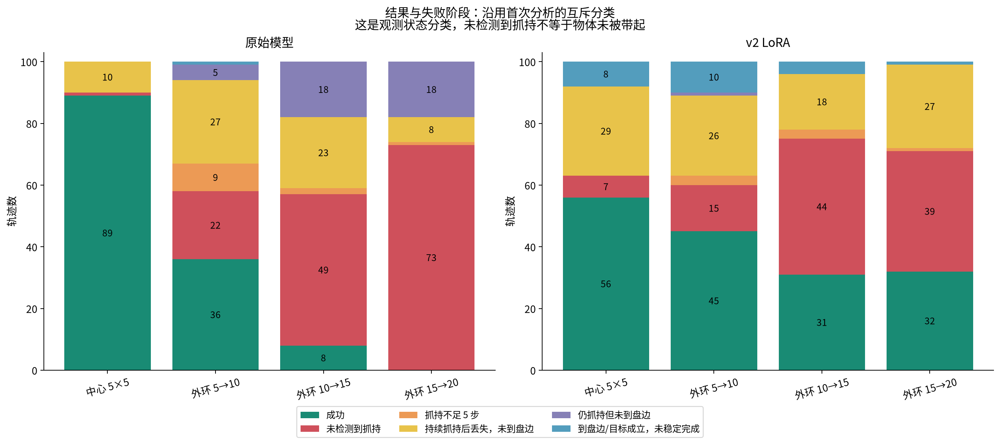
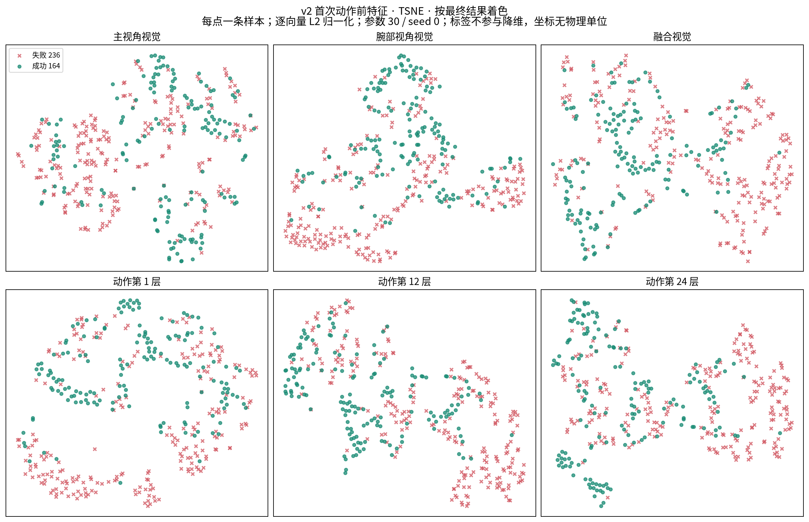
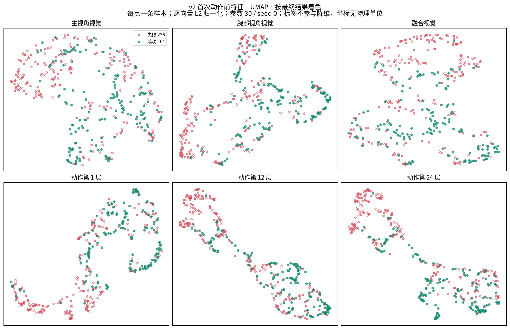

# v2 LoRA：400点重测与分析

同一400点、init0、seed195、30步动作块、520步上限。比较基座模型和50条抓取覆盖增强版v2 LoRA，成功要求连续20步目标成立、未抓持且速度<0.01m/s。

|区域|原始模型|v2|
|---|---:|---:|
|中心5×5cm|89/100|56/100|
|第一外环|36/100|45/100|
|第二外环|8/100|31/100|
|第三外环|0/100|32/100|
|全部|133/400 (33.25%)|164/400 (41.00%)|

90点改善、59点退步，净增加31点。面积加权口径为16.66%→36.14%，与样本均值不同。中心下降、外围改善，不能称为全面提升。固定单场景单种子，不代表完整LIBERO基准。








18组图均提供PNG/SVG/PDF。完整目录可下载后用浏览器打开 `index.html`。图表数据、首查询池化特征、嵌入坐标、空间探针划分与代码均在本目录。

首查询的主视角、腕部和融合视觉特征与原始模型逐元素一致，动作层有变化。降维与失败阶段仅为描述性分析，不提供因果证明。位置探针两模型共享空间划分，固定alpha=1，与原报告的调参探针设置不同。

## 重绘

安装仓库根目录的分析依赖及Noto Sans CJK后，从仓库根目录执行：

```bash
python analysis/mug_v2_400_retest_20261119/scripts/plots.py analysis/mug_v2_400_retest_20261119
```

特征分析脚本需要 `XVLA_ROOT` 指向含原始基座特征数据的目录。参考采集脚本见 `reference/mug_v2_400_retest_20261119`，它们不是独立安装包。完整限制见 [说明](README.zh.txt)。

## 原始数据

[GitHub Release：400份完整HDF5、400段MP4、轨迹与指标](https://github.com/qihaoshen0907/xvla-position-generalization/releases/tag/v2-400-20261119)。每个ZIP分包独立可解压，全部解压到同一目录。用SHA256SUMS校验下载文件；每回合文件清单见Release中的EPISODE_FILES.json。
